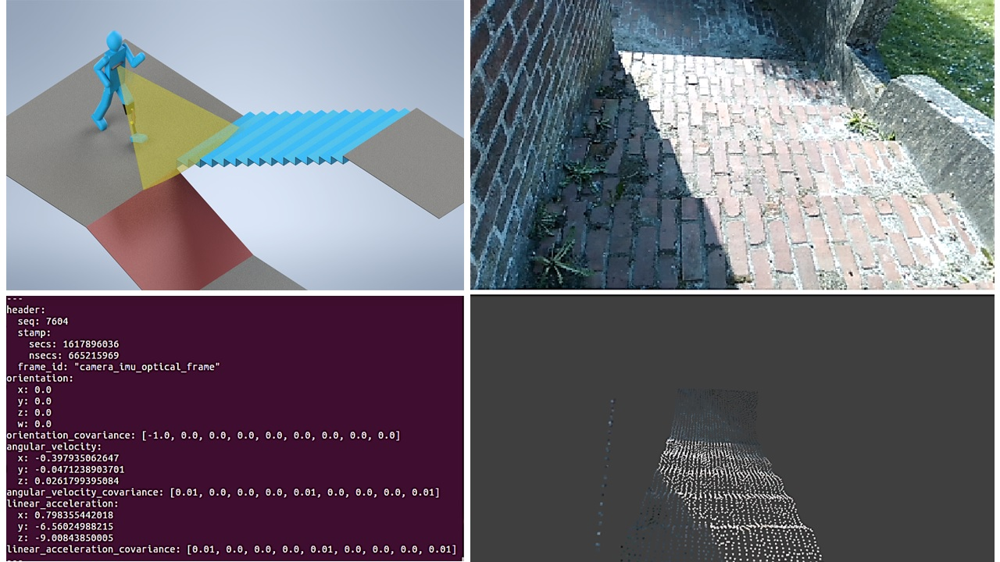
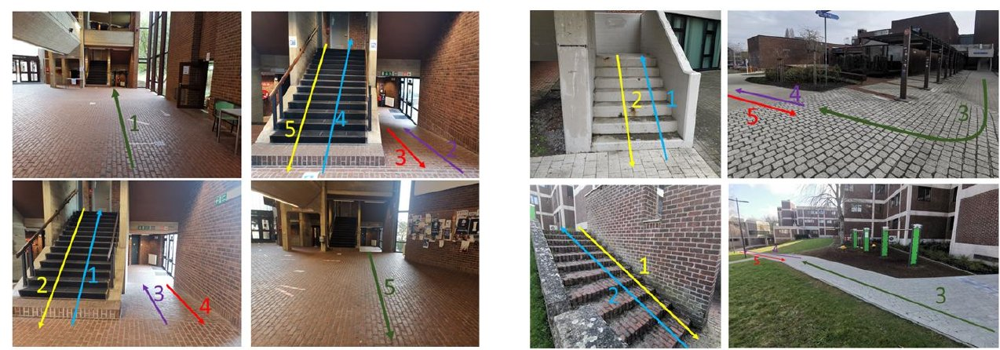
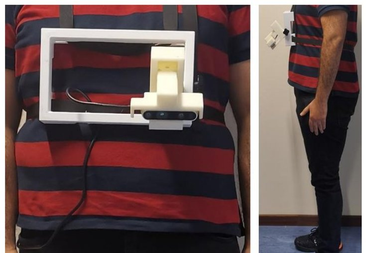
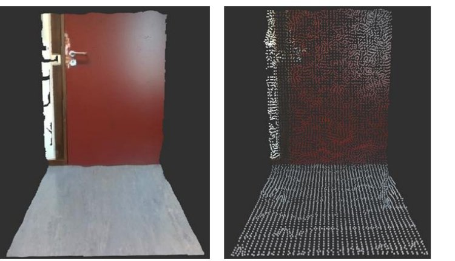

# 3D Point Cloud Dataset of Urban Terrains Recorded During Human Locomotion

[](https://doi.org/10.14428/DVN/S0LSIW)
[](https://www.kaggle.com/datasets/alialdabbagh/3d-point-cloud-dataset-of-various-terrains)

**64 recordings** of down-sampled 3D point clouds, IMU data and RGB images from a
**chest-mounted Intel RealSense D435i** while **8 people walk over level ground, ramps and
stairs** on two indoor and two outdoor urban paths. Each path is recorded with a clear view
and with the view **partially occluded by another person walking ahead**.

The dataset was built during my Ph.D. at UCLouvain to develop vision-based terrain detection
for **powered prostheses, exoskeletons and wheelchairs**. It is equally useful for
terrain-aware navigation of humanoid and legged robots.


*Top left: the chest-mounted camera looks at the terrain ahead. Top right: RGB frame
(ground truth). Bottom left: IMU message. Bottom right: the matching down-sampled point cloud
of a descending staircase.*

📥 **Download:** [Open Data @ UCLouvain (DOI 10.14428/DVN/S0LSIW)](https://doi.org/10.14428/DVN/S0LSIW)
· [Kaggle mirror](https://www.kaggle.com/datasets/alialdabbagh/3d-point-cloud-dataset-of-various-terrains)
<br>🎥 **Demo:** https://youtu.be/egoPBV8I34c
<br>💻 **Terrain-detection code developed on this data:** https://github.com/Ali-Aldabbagh/terrain-detection

## At a glance

| | |
|---|---|
| Participants | 8 healthy subjects (5 male, 3 female), aged 24–43 |
| Paths | 4 (2 indoor, 2 outdoor), each with **5 locomotion modes**: level ground, stair ascent, stair descent, ramp ascent, ramp descent |
| Conditions | **Clear** path, and **partially occluded**: a second person walks ahead, tied by a 0.9 m rope to keep the distance constant |
| Recordings | 8 subjects × 4 paths × 2 conditions = **64 ROS bag files** |
| Sensor | Intel RealSense D435i (stereo depth + built-in IMU) on a 3D-printed chest mount |
| Camera pitch | 45–55° below the horizontal |
| Extras | Sensor height above ground (*hos*) for every trial |

## Paths


*Left: the two indoor paths. Right: the two outdoor paths. Numbers and arrows give the walking
order and direction over each path. Slopes, lengths and step heights differ between paths.*

## Hardware and protocol



The D435i is held on the chest by a 3D-printed mount that lets the detection angle be
adjusted. It is connected by a long cable to a laptop, which an experimenter carried during
each trial, so the user could walk naturally.

Subjects walked at their normal speed. Before each trial, they **stood still for a few
seconds facing flat ground**. Those first seconds can be used to calibrate the camera pitch
and height, and the sensor height (*hos*) reported for each trial was measured during this
period.

<br clear="right">

## Recorded data

| Topic | Message type | Content |
|---|---|---|
| `/cdsac` | `sensor_msgs/PointCloud2` | **Down-sampled point cloud**: 3D voxel-grid filter with 4 cm leaves, cropped to a 1 m wide region of interest in front of the user |
| `/camera/imu` | `sensor_msgs/Imu` | Angular velocity and linear acceleration from the camera's IMU, used to align the cloud with the world frame |
| `/camera/color/image_raw` | `sensor_msgs/Image` | RGB image, useful to see the path condition and to label the ground-truth terrain |


*The raw cloud (left, ~60,500 points) is reduced to ~7,500 points (right) with the voxel-grid
filter, keeping the terrain geometry while making real-time processing possible.*

## Files and folders

```
M1/ M2/ M3/ M4/ M5/      male subjects 1–5
F1/ F2/ F3/              female subjects 1–3
└── each subject folder
    ├── Ind1_clear.bag   indoor path 1, clear
    ├── Ind1_occ.bag     indoor path 1, partially occluded
    ├── Ind2_clear.bag   indoor path 2, clear
    ├── Ind2_occ.bag     indoor path 2, partially occluded
    ├── Out1_clear.bag   outdoor path 1, clear
    ├── Out1_occ.bag     outdoor path 1, partially occluded
    ├── Out2_clear.bag   outdoor path 2, clear
    ├── Out2_occ.bag     outdoor path 2, partially occluded
    └── *.txt            sensor height (hos, metres) for each path
```

## Getting started

### Without ROS (Windows, macOS, Linux)

The scripts in [`tools/`](tools) read the bags with the pure-Python
[`rosbags`](https://pypi.org/project/rosbags/) library, so ROS isn't needed.

```bash
pip install rosbags numpy matplotlib

# list topics in a recording
python tools/extract_bag.py M1/Ind1_clear.bag

# export point clouds (.npy, optionally .pcd) and IMU (.csv)
python tools/extract_bag.py M1/Ind1_clear.bag -o out/ --pcd

# also export RGB frames (needs opencv-python), every 5th frame
python tools/extract_bag.py M1/Ind1_clear.bag -o out/ --images --every 5

# look at one cloud
python tools/view_cloud.py out/cdsac/<timestamp>.npy
```

### With ROS (Kinetic or newer)

```bash
roscore
rosbag play M1/Ind1_clear.bag      # in a second terminal
rostopic list                      # /cdsac, /camera/imu, /camera/color/image_raw
rviz                               # add PointCloud2 (/cdsac) and Image displays
```

The [terrain-detection](https://github.com/Ali-Aldabbagh/terrain-detection) package subscribes
to these topics directly and classifies the terrain in real time.

**Coordinate frame:** clouds are in the camera's optical frame (x right, y down, z forward, in
metres). Use the IMU's gravity vector, or the standing-still calibration at the start of each
trial, together with *hos* to rotate them into a ground-aligned frame.

## Citation

If you use this dataset, please cite it together with the related papers:

```bibtex
@misc{aldabbagh2021terraindataset,
  author    = {Al-Dabbagh, Ali Hussein and Ronsse, Renaud},
  title     = {{3D-Point Cloud dataset of various geometrical terrains in urban
                environments recorded during human locomotion}},
  year      = {2021},
  publisher = {Open Data @ UCLouvain},
  version   = {V2},
  doi       = {10.14428/DVN/S0LSIW},
  url       = {https://doi.org/10.14428/DVN/S0LSIW}
}
```

Related papers:
1. "Depth Vision based Terrain Detection Algorithm during Human Locomotion," IEEE, 2022.
   https://ieeexplore.ieee.org/abstract/document/9891830
2. "Using Depth Vision for Terrain Detection during Active Locomotion," IEEE, 2021.
   https://ieeexplore.ieee.org/abstract/document/9636077
3. A. H. Al-Dabbagh and R. Ronsse, "A review of terrain detection systems for applications in
   locomotion assistance," *Robotics and Autonomous Systems*, p. 103628, 2020.

## License

The **data** is distributed by Open Data @ UCLouvain under the license shown on its
[Dataverse page](https://doi.org/10.14428/DVN/S0LSIW). The **scripts** in this repository
are released under the [MIT License](LICENSE-code).

## Author

**Ali Al-Dabbagh**, Ph.D., UCLouvain · [ali-aldabbagh.github.io](https://ali-aldabbagh.github.io)
<br>Supervisor: Prof. Renaud Ronsse, UCLouvain
